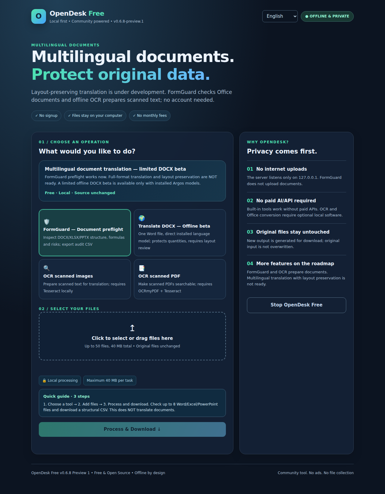

# OpenDesk Free — free, private tools for everyone 🧰

**English · Tiếng Việt** | **No subscription · No account · Offline-first**



[Download for Windows](https://github.com/black11023/opendesk-free/releases) · [Report a bug](https://github.com/black11023/opendesk-free/issues) · [Contribute](CONTRIBUTING.md) · [Roadmap](docs/ROADMAP.md)

> **v0.6.5-preview.1 — Windows 10/11 x64 preview.** Automated tests, Windows executable builds and a local HTTP runtime smoke test run on GitHub Actions. End-user Windows installation and third-party converter accuracy are not yet certified. Executables are unsigned.

OpenDesk Free provides a friendly desktop launcher for essential document operations without paid cloud APIs. English is the default; switch to **Tiếng Việt** at any time. The application runs on `127.0.0.1` and does not upload your files.

## Features — truthful availability

| Feature | State | Details |
|---|---|---|
| PDF merge, select/split/reorder pages, rotate | **Built-in** | Choose page ranges |
| **PDF batch audit → CSV** | **Built-in (V0.6.2)** | 1–50 documents, valid/invalid status, pages, SHA-256, filenames, byte sizes |
| PNG/JPG → PDF | **Built-in** | Max 25 images |
| CSV → XLSX, DOCX → plain text | **Built-in** | Original files stay unchanged |
| Organize ZIP, SHA-256 duplicate detection, text merge | **Built-in** | Download new results |
| Image OCR → TXT/searchable PDF | **Optional local adapter** | Install Tesseract and language data |
| Scan-PDF → searchable PDF | **Optional local adapter** | Install OCRmyPDF + Tesseract |
| Word/Excel/PowerPoint → PDF | **Optional local adapter** | Install LibreOffice separately |
| **Office batch → ZIP + CSV** | **Optional local adapter (V0.6.3)** | 2–8 files; preserves successful PDFs and reports individual failures |
| 44 free software links, 11 categories | **Directory only** | External projects, not integrated |
| FFmpeg, workflow automation, more platforms | **Planned** | Not yet available |

### Install and use

1. Open [Releases](https://github.com/black11023/opendesk-free/releases). Download the newest `OpenDeskFree_Setup_*.exe` or the Portable EXE.
2. Check `SHA256SUMS.txt`. These EXEs are unsigned; do not blindly bypass system security warnings.
3. Launch OpenDesk, select English or Vietnamese, choose an operation and drop your files into the window.
4. To enable **Office → PDF**, install [LibreOffice](https://www.libreoffice.org/) separately and follow [Office setup](docs/OFFICE_LOCAL_SETUP.md). To enable OCR use [OCR setup](docs/OCR_LOCAL_SETUP.md).

### Safety and limits

Built-in operations work offline without registration. Optional adapters run installed third-party programs locally, never download binaries for you, and store data in a private temporary workspace cleaned after processing.

- Typical maximum: 50 input files / 40 MB combined, with smaller limits per tool.
- Office conversion: **1–8 files**, 40 MB input, 250 pages per generated PDF, 500 pages and 80 MB of combined output; 1 input → 1 PDF, multiple inputs → ZIP.
- DOCX/Excel/PowerPoint rendering can change fonts, layout and pagination. Always inspect resulting PDFs before submitting important documents.
- Local server binds only `127.0.0.1`, with per-session token and origin checks, no telemetry, no cloud storage. External tools are **not** a hardened sandbox: avoid untrusted documents.

### Build and contribute

Go 1.26+; first build needs the Go dependencies. Windows:

```powershell
go mod tidy
go test ./...
go vet ./...
go build -o OpenDeskFree_Portable.exe ./cmd/opendesk
go build -ldflags "-H=windowsgui" -o cmd/setup/payload/OpenDeskFree.exe ./cmd/opendesk
go build -ldflags "-H=windowsgui" -o OpenDeskFree_Setup.exe ./cmd/setup
```

[Build workflow](.github/workflows/build-windows.yml) · [Contributing guidelines](CONTRIBUTING.md) · [Project roadmap](docs/ROADMAP.md) · [External integrations and licenses](docs/LICENSES_AND_INTEGRATIONS.md)

Community contributions, translations and test reports are welcome. Never attach personal documents to public issues. A successful GitHub Actions build does not prove third-party conversion accuracy on a user's PC.

**License:** MIT for OpenDesk's original code. Independent tools retain their own licenses and trademarks.

### Runtime and reliability hardening (V0.5.1)

- The actual compiled Windows Portable EXE is now started in CI, with its browser launch disabled only for testing. CI probes the live local HTTP server and exercises an authorized file-processing request plus forbidden/malformed requests.
- Two document operations can run at the same time; additional calls receive HTTP 429 instead of accumulating unbounded jobs in memory.
- Built-in PDF/image operations now receive the client request context, allowing cancellation to propagate where supported by pdfcpu.
- Download filenames use standards-aware Unicode content disposition and client parsing. These improvements do not change the no-cloud architecture.

### Stateless PDF engine

OpenDesk disables pdfcpu's persistent configuration directory at process initialization. Document operations use pdfcpu's built-in default PDF configuration and no longer create or update a shared per-user `pdfcpu/config.yml`. This avoids first-run config write contention on Windows and does not touch existing pdfcpu settings. Custom user-installed PDF fonts/configuration from that directory are deliberately not used by these built-in operations.

### Windows installer acceptance (v0.5.2)

GitHub Actions now launches the actual unsigned Windows Setup EXE in an **isolated temporary per-user profile directory**. It verifies install and Installed Apps registry entry, reruns Setup as an upgrade, launches the installed desktop process on localhost, uninstalls, and confirms that user-created files survive. This is stronger than compilation alone, but it does **not** replace acceptance testing on real Windows 10/11 PCs, malware scanning, signed releases or end-user GUI-dialog verification.

Automation supports explicit `--quiet-install` and `--quiet-uninstall` switches. They operate only within the current user's default Local AppData installation path and never request elevation. Ordinary interactive Setup/Uninstall prompts remain available.

### Real document integration gates (V0.6)

A second Linux GitHub Actions job now installs **real LibreOffice, Tesseract (English and Vietnamese traineddata), OCRmyPDF and pdftotext**. It generates tiny reproducible DOCX, XLSX and scanned PNG documents and asserts the text contents of rendered PDFs and OCR output. Unlike earlier injected mock tests, these calls invoke the real local third-party engines. Windows installation acceptance remains in a separate CI job; conversion layout fidelity on an end-user Windows PC is still unverified. View [.github/workflows/real-document-integration.yml](.github/workflows/real-document-integration.yml).

### V0.6.1 Preview 1 — browser, PowerPoint and memory gates

- The real Linux LibreOffice integration job generates a two-slide PPTX with shapes, text and an embedded graphic. It checks that its PDF has exactly two pages and both slide titles, and also converts a three-format DOCX+XLSX+PPTX batch. This proves these fixtures' structural/text results, **not pixel-perfect visual fidelity** for every presentation.
- A separate Chromium UI job opens the compiled application, searches/filters tools, switches English/Vietnamese, selects page 2 from a real PDF, downloads a selected PDF and a batch-rotation ZIP, and uploads bilingual screenshots and a Linux process RSS measurement. Screenshots are evidence for review, not certification of visual quality.
- Repeated 5-PDF batch rotations are checked for retained Go heap regression after garbage collection. Combined upload bytes are now rejected before copying files into memory. Heap/RSS measurements of small fixtures are **not a hard RAM limit**, and separately installed LibreOffice/OCR tools are not covered by Go-only caps.

### V0.6.2 Preview — per-file PDF audit

The built-in **Audit PDF files → CSV** tool inspects up to 50 inputs (40 MB total) without modifying any original. It produces an Excel-compatible UTF-8 CSV containing one row per file with source name, PASS/FAIL, validated page count, bytes, SHA-256 and a brief error description. Malformed files are included as **FAIL rows** rather than silently omitted. Suspicious spreadsheet-formula prefixes in filenames are neutralized in the CSV output. This is a document integrity inventory, not a malware detector, electronic signature validator or digital forensics service.

### V0.6.3 Preview 1 — resilient Office batches & tested release gating

- New independent **Office batch → PDF + report** operation. Select 2–8 Office documents; one ZIP includes each successfully generated PDF and an Excel-compatible CSV with one PASS/FAIL row and SHA-256 per original, including failures. This is deliberately distinct from the existing all-or-nothing Office → PDF operation. A ZIP may contain only the failure report when no conversion succeeded; this never pretends the documents converted.
- External Office/OCR converter operations share a **single admission slot** across LibreOffice/Tesseract/OCRmyPDF; a second simultaneous job receives a bilingual HTTP 429 instead of starting another resource-intensive subprocess. Normal built-in jobs can still run alongside one external job. This is an admission/concurrency limit, **not** an OS-wide process RAM cap.
- Public previews are now published by [a dedicated three-gate workflow](.github/workflows/release-preview.yml): it checks the exact current `main` commit for PASS results from the Windows, actual Office/OCR and Chromium workflows, downloads the tested Windows artifacts, verifies SHA-256 and then publishes. A missing, failed or cancelled gate blocks release.

### V0.6.4 Preview 1 — cancellable external process trees

- The local Office and OCR adapters now launch external converters as distinct process groups on Linux/macOS, and a separate Windows process group with `taskkill /T /F` tree termination on cancellation. This is a **best-effort cleanup of descendants after request cancellation/timeouts**, not a hard memory or CPU sandbox.
- Chromium CI runs a Linux regression that intentionally starts a shell plus background child, cancels the request, and confirms the child is no longer running. Windows builds compile platform-specific cancellation support; an exhaustive Windows worker-process-tree test remains a future requirement.
- Fixes the README feature-table formatting so international users can distinguish built-in, optional, planned and directory-only features.

### V0.6.5 Preview 1 — beginner-friendly file selection

- The local workbench now explains each selected operation in **three short steps** in English and Vietnamese, including the output format. Help remains available entirely offline.
- The file picker filters extensions for built-in text/CSV tools, PDF, image, OCR and optional Office operations. Drag/drop of unsupported extensions shows a clear bilingual warning **before processing** and disables the Process button.
- **PDF batch audit** and **Office batch → PDF + report** deliberately continue accepting invalid file extensions: their CSV reports include each as a **FAIL**, rather than silently discarding inputs.
- Fix the Office batch operation appearing under **Files** instead of **Office**.
- All core conversion semantics and source-preserving behavior are unchanged. This remains an unsigned Preview, not an offline replacement for complete Office applications.
